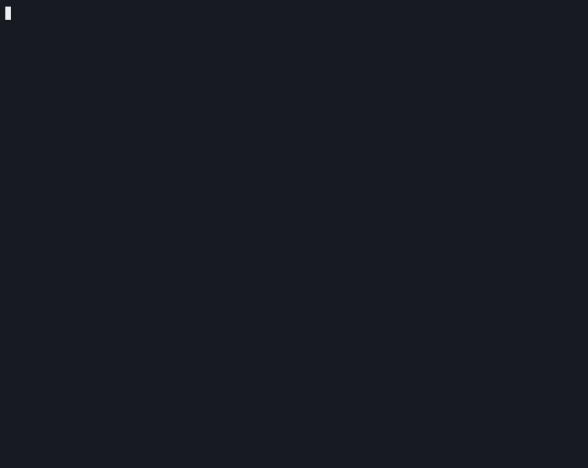
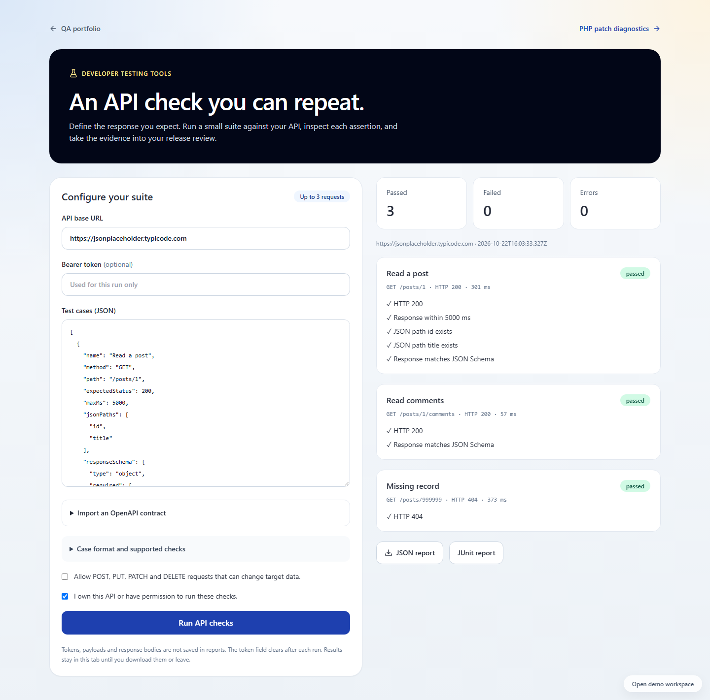
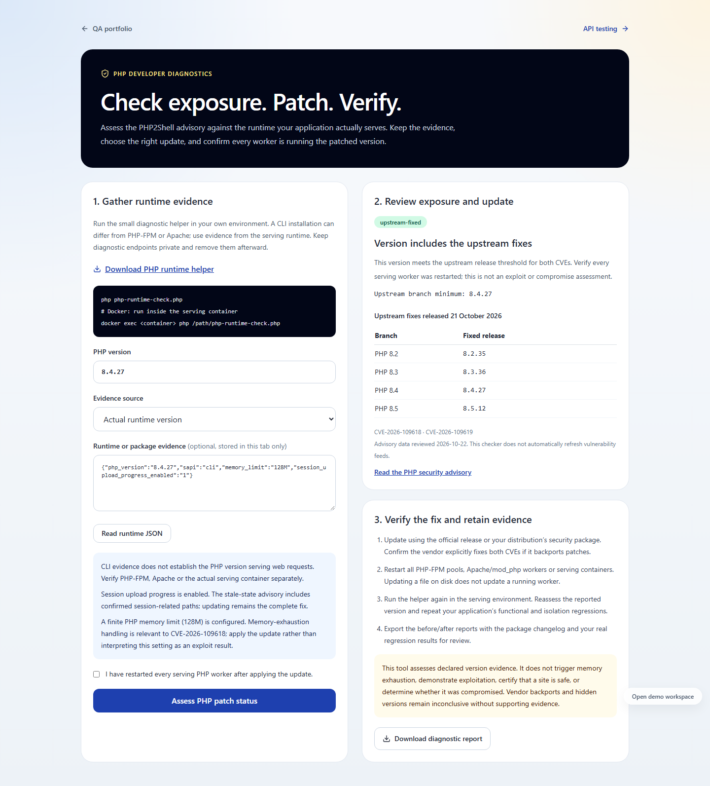
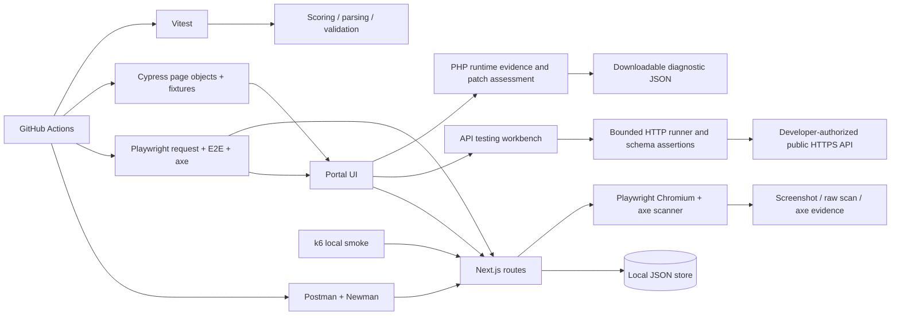
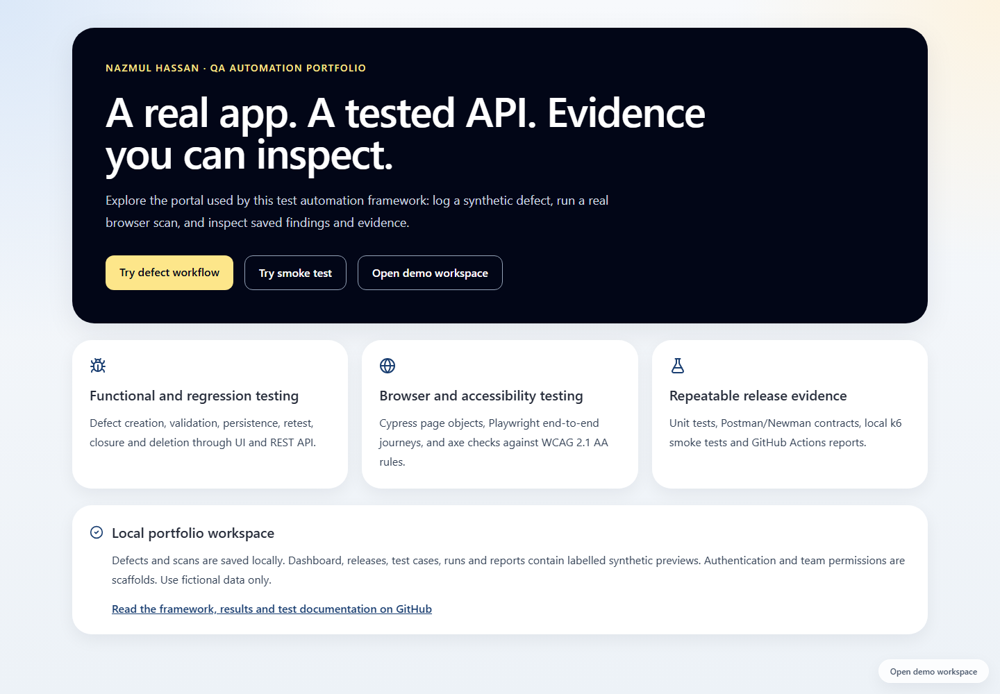
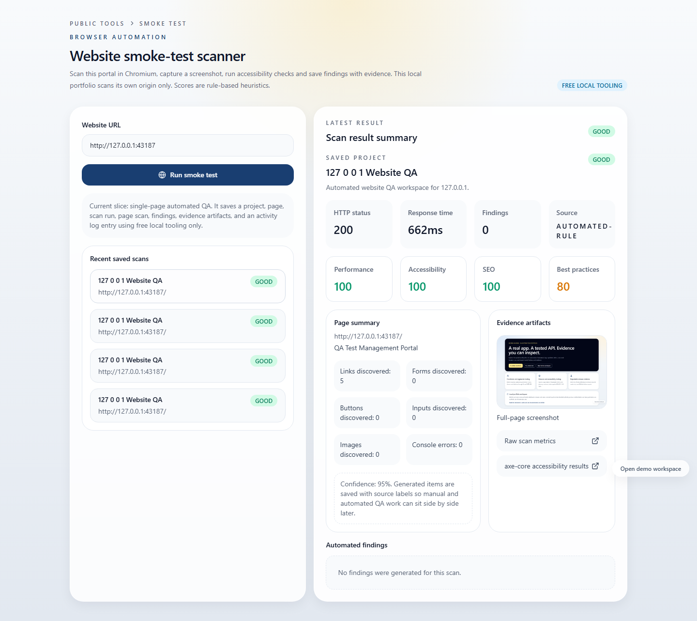
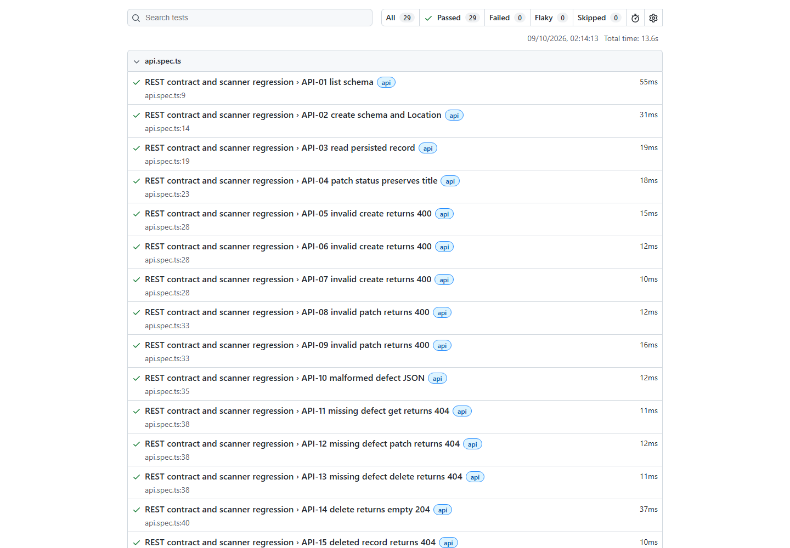
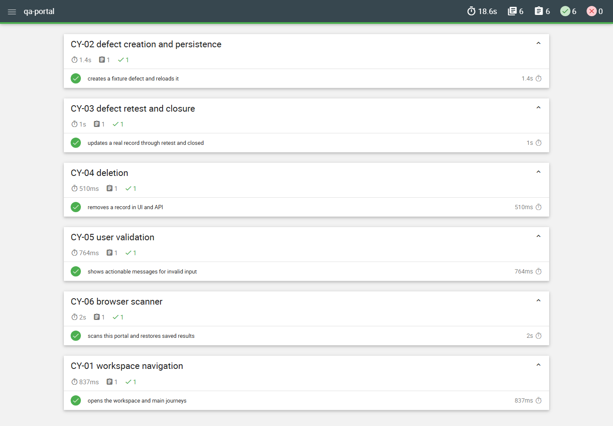

# QA Automation

I built a developer testing portal with reusable API checks and PHP patch diagnostics, and tested an independent Git hosting product with reproducible defects and release evidence.



[](https://github.com/iamnajib71/qa-automation/actions/workflows/ci.yml) · [MIT licence](LICENSE)

## At a glance

| Area | Evidence-backed summary |
| --- | --- |
| **The problem** | A QA analyst and release team need to know whether defects survive reloads, invalid input gets a useful response and missing projects are identified correctly; misleading results cause repeated triage and weaken release decisions. This portal uses synthetic fixtures. |
| **What I built** | I built reusable API checks and PHP patch diagnostics into the portal. I tested Gitea independently in Docker with manual cases, exploratory sessions, Selenium, Playwright, API contracts and accessibility checks. |
| **Results** | Gitea: [31 automated checks: 25 passed, 6 failed; 30 manual cases authored, 12 completed and 5 partial/inconclusive](real-world/gitea/evidence/summary.json). [Three exploratory sessions](real-world/gitea/exploratory/README.md) and [four confirmed defect classes](real-world/gitea/defects/README.md). Original portal CI results remain [separately recorded](docs/results/ci-summary.json). |
| **Skills shown** | Functional testing, regression testing, API testing, Selenium, Python, pytest, Page Object Model, Playwright, Cypress, Postman, Newman, Schemathesis, accessibility testing, GitHub Actions and Azure Pipelines. |
| **Relevant roles** | QA Analyst, Test Analyst, Junior Test Automation Engineer, Software Tester. |
| **How it was built** | Designed, specified and reviewed by me; built with Codex as my coding agent (vibe coding). Verification and its limits are linked below. |
| **Try it / evidence** | [Live API tester](https://qa-automation-one.vercel.app/api-testing) · [PHP diagnostics](https://qa-automation-one.vercel.app/php-security) · [Demo](docs/demo.gif) · [CI evidence](docs/results/ci-summary.json) · [Quick start](#quick-start--windows-powershell) |

## Real-world testing

I selected **Gitea 28.2.0**, an independent open-source Git hosting and issue-tracking product, to test repository privacy, authentication and saved issue changes. [Choice and reproduction steps](real-world/gitea/README.md) · [risk-based plan](real-world/gitea/test-plan.md).

**Real results, including failures:** [30 manual cases](real-world/gitea/manual-cases.csv), [12 completed/5 partial or inconclusive/13 not run](real-world/gitea/manual-results.csv), [3 exploratory sessions](real-world/gitea/exploratory/README.md), and **31 automated checks: 25 passed, 6 failed**. Findings are grouped into **4 distinct defect classes** after source triage. [JUnit-derived summary](real-world/gitea/evidence/summary.json) · [traceability CSV](real-world/gitea/evidence/traceability.csv) · [defect table](real-world/gitea/defects/README.md).

The suites cover Selenium in headless Chrome/Firefox, Playwright journeys, pytest/requests API checks, served Swagger response validation and axe accessibility checks. [Actual GitHub run and downloadable reports](https://github.com/iamnajib71/qa-automation/actions/runs/39808735895) reproduced 25 passes and 6 failures. [GitHub Actions](.github/workflows/real-world.yml) and [Azure Pipelines](azure-pipelines.yml) retain JUnit, HTML and Allure result artifacts; Azure is configured but has not been run. Unresolved product failures remain visible; no clean release is claimed. [Execution details and limits](real-world/gitea/evidence/execution-status.md) · [regression-tested contract fix for submission](real-world/gitea/fixes/README.md).

## Developer tools in the portal

- **API Testing** at `/api-testing`: configure an HTTPS API and up to three cases, import supported OpenAPI/Swagger GET operations, check status/time/JSON/schema assertions, and download JSON/JUnit evidence. Tokens and response bodies are not saved. [Usage and hosted limits](docs/developer-tools.md).
- **PHP Diagnostics** at `/php-security`: collect serving-runtime evidence, assess the two published PHP2Shell CVEs, follow the upstream/vendor patch path, restart workers and export a before/after assessment. Hidden versions and vendor backports remain inconclusive without evidence. This is version/configuration triage, not an exploit or overload scanner. [Developer workflow](docs/php-diagnostics.md).

[Portal verification](docs/results/developer-tools-summary.json): 59 unit tests and 5 focused local browser checks passed, including axe on both tool pages. The [full portal CI run](https://github.com/iamnajib71/qa-automation/actions/runs/39808735765) also passed all gates, including 34 Playwright API/UI checks and Cypress. These counts are separate from the Gitea product results.




## What I did, step by step

1. Reviewed the portal and defined its working features, exclusions and release risks in the [test strategy](docs/testing/test-strategy.md).
2. Mapped functional cases to requirements and evidence in the [traceability matrix](docs/testing/traceability.md).
3. Reproduced real failures before fixing them and retained the [before/after responses](docs/results/defects-before.json).
4. Automated the API contract and browser journeys with independent request, UI and accessibility checks.
5. Added ordered CI gates and downloadable failure reports, keeping the performance smoke run separate from correctness gates.
6. Retested the fixes and repeated installation and execution from a [fresh public clone](docs/results/clean-clone.json).
7. Ran Gitea in Docker, completed three focused exploratory sessions, recorded manual outcomes, and reproduced contract/accessibility findings with cross-browser and CI evidence. Prepared reports for review without posting upstream.
8. Added reusable API and PHP diagnostic tools to the portal, with network-boundary tests, patch-version checks and downloadable developer evidence.

## Problems I hit and how I solved them

- **Malformed scanner JSON returned a server error:** separated request parsing from scan execution and added a permanent regression for the expected validation response. [BUG-001 and fixing commit](docs/testing/bug-reports/BUG-001.md).
- **A valid API-tool request returned 403 locally:** Next.js exposed a different internal host from the browser's origin. I compared the browser-facing Host and scheme, added an origin regression, and retested the public example in the browser. [Origin checks](src/lib/api-testing/origin.ts) · [tool verification](docs/results/developer-tools-summary.json).
- **Missing projects appeared to exist:** stopped using an empty scan history as the existence check and retested the missing-project response. [BUG-003 and fixing commit](docs/testing/bug-reports/BUG-003.md).
- **Docker could not start because runtime sockets were stale:** preserved the failed socket directories and restarted Docker without deleting images/volumes, then ran Gitea. Initial selector and contract-check mistakes were corrected separately from genuine product failures. [Execution record](real-world/gitea/evidence/execution-status.md).

## Architecture



## Screenshots






## Quick start — Windows PowerShell

Tested with Node 22 and Windows. No secrets, external services or environment file are required. The shared port is 43187; lower development ports became reserved by Windows during verification.

```powershell
git clone https://github.com/iamnajib71/qa-automation.git
cd qa-automation
npm.cmd ci
npx.cmd playwright install chromium
npm.cmd test
npm.cmd run build
npm.cmd run serve:test
```

Open **http://127.0.0.1:43187**. Create a fictional defect at /defects; at /smoke-test scan **http://127.0.0.1:43187**. Reload to inspect saved data. Use Ctrl+C to stop the server before suites that start their own server. On Ubuntu, use npm/npx and install Chromium with `npx playwright install --with-deps chromium`.

### One command per suite

Run after installation and build. The API and Cypress commands start and stop the production server; Playwright manages its server too. Only k6 expects an already running production server.

| Suite | Command | Report |
|---|---|---|
| Lint | `npm run lint` | Terminal |
| Type-check | `npm run typecheck` | Terminal |
| Unit (Vitest) | `npm test` | reports/unit JSON + JUnit |
| API (Postman/Newman) | `npm run test:api` | reports/newman/index.html + JSON + JUnit |
| API (Playwright request) | `npm run test:request` | reports/playwright/index.html |
| Playwright request + E2E + axe | `npm run test:e2e` | reports/playwright/index.html + trace/axe attachments |
| Cypress six journey specs | `npm run test:cypress` | reports/cypress/index.html + JSON; videos |
| Performance smoke (local only) | `npm run test:perf` | docs/results/k6-summary.json |
| All correctness gates | `npm run test:all` | All reports above; excludes k6 |

On PowerShell, use `npm.cmd` if script execution policy blocks `npm`. Install the free [k6 CLI](https://grafana.com/docs/k6/latest/set-up/install-k6/) separately and place it on PATH for the performance command. Cypress installation is included in npm ci; `npx cypress install` repairs a missing binary. [API contract and Postman import](docs/testing/api-contract.md).

## Results and evidence

[GitHub CI run](https://github.com/iamnajib71/qa-automation/actions/runs/37802529519) · [saved counts](docs/results/ci-summary.json). Counts below are read from that run's reports; requests and assertions are explicitly distinguished. Fixtures are synthetic; scan metrics are measured from this real portal. No coverage percentage is claimed.

| Suite | Passed | Failed | Evidence |
|---|---:|---:|---|
| Vitest unit | 32 tests | 0 | [CI counts](docs/results/ci-summary.json) |
| Newman API | 21 requests / 44 assertions | 0 | [CI counts](docs/results/ci-summary.json) |
| Playwright request | 22 tests | 0 | [CI counts](docs/results/ci-summary.json) |
| Playwright E2E + accessibility | 7 tests | 0 | [CI counts](docs/results/ci-summary.json) |
| Cypress | 6 tests across six specs | 0 | [CI counts](docs/results/ci-summary.json) |
| k6 (local only) | 74 requests / 148 checks; p95 11.81 ms | 0% HTTP errors; 0 failed checks | [Local summary](docs/results/k6-summary.json), [raw output](docs/results/k6-output.txt) |

[Windows execution snapshot](docs/results/local-summary.json) · [clean-clone verification](docs/results/clean-clone.json) · [BUG-001](docs/testing/bug-reports/BUG-001.md) · [BUG-002](docs/testing/bug-reports/BUG-002.md) · [BUG-003](docs/testing/bug-reports/BUG-003.md).

[CI workflow and artifact retention](.github/workflows/ci.yml). CI gates: lint → type-check → unit → Newman API → Playwright → Cypress. Every job must pass. HTML reports, JSON/JUnit, failure screenshots, retained Playwright videos/traces and Cypress videos are uploaded as Actions artifacts for 30 days. Performance runs locally only. Screenshots show the inspected Windows reports; the linked CI artifacts contain the exact CI reports.

## Project structure

```text
src/app/api/          defects REST routes and real scanner route
src/lib/             shared JSON store, validation and scoring
tests/unit/          pure-function boundary and validation tests
tests/api/           exported Postman collection
tests/playwright/    request, E2E and axe tests
cypress/             six specs, page objects and synthetic fixtures
tests/performance/   local-only k6 smoke script
docs/testing/        strategy, plan, 40 cases, traceability, bug reports
docs/results/        actual execution snapshots and recording provenance
docs/img/            app and report screenshots
.github/workflows/   ordered CI gates and artifact uploads
scripts/             cross-platform runners and evidence utilities
```

## Honest limits

This is a junior QA portfolio framework, not a production multi-tenant service. Defects and scans work; dashboard/release/test-case/run/report pages contain labelled synthetic previews. Authentication/Supabase scaffolds are excluded from testing. The JSON writer supports one Node process. Saved local records and generated scan artifacts are ignored by Git.

The scanner accepts its own origin only and blocks browser requests to other origins. Browser launch failure can trigger a legacy HTML fallback; the automated happy paths reject fallback and require real Chromium evidence. axe checks do not replace manual accessibility testing. Playwright runs Chromium only; Cypress runs Electron. k6 is a short warmed local GET smoke test, not capacity or production benchmarking. Some transitive development/build dependencies remain flagged by npm audit; no claim of security certification is made.

## Built by Nazmul Hassan

[LinkedIn](https://www.linkedin.com/in/iamnajib71) · [GitHub](https://github.com/iamnajib71)
